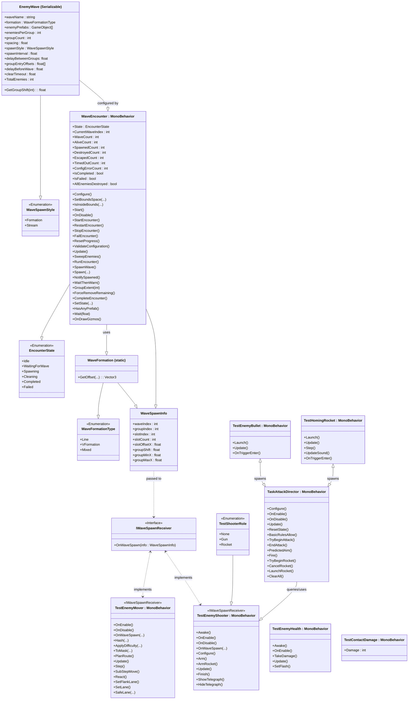

# GDD v.1 contribution

Established general enemy behavior concepts and identifies enemy parameters

# Prototype summary

Basic enemy movement, single enemy type, two projectile types, basic wave configuration.

# Enemy mechanics architecture:

## EnemyWave.cs

Wave definition class:

- Wave identification
- Wave formation
- Enemy prefabs selection
- Number of enemies per group
- Number of groups per wave
- Spawn behavior (simultaneous/individual)
- Spawn location (left/center/right)
- Wave duration
- Wave delay (display game info)

## WaveEncounter.cs

Executes waves, spawns enemies, monitors their status and manages encounter completion

- Starting and stopping encounters
- Progressing through multiple waves
- Spawning enemy groups
- Tracking active enemies
- Detecting destroyed and escaped enemies
- Handling timeouts
- Reporting encounter events to other systems
- Determining when an encounter is completed or failed

## WaveFormation.cs

Calculates the initial positions of enemies within a group

- Generating line formations
- Generating V-shaped formations
- Generating mixed formations
- Calculating horizontal spacing between enemies
- Determining each enemy's position relative to the spawn origin

## Class diagram

