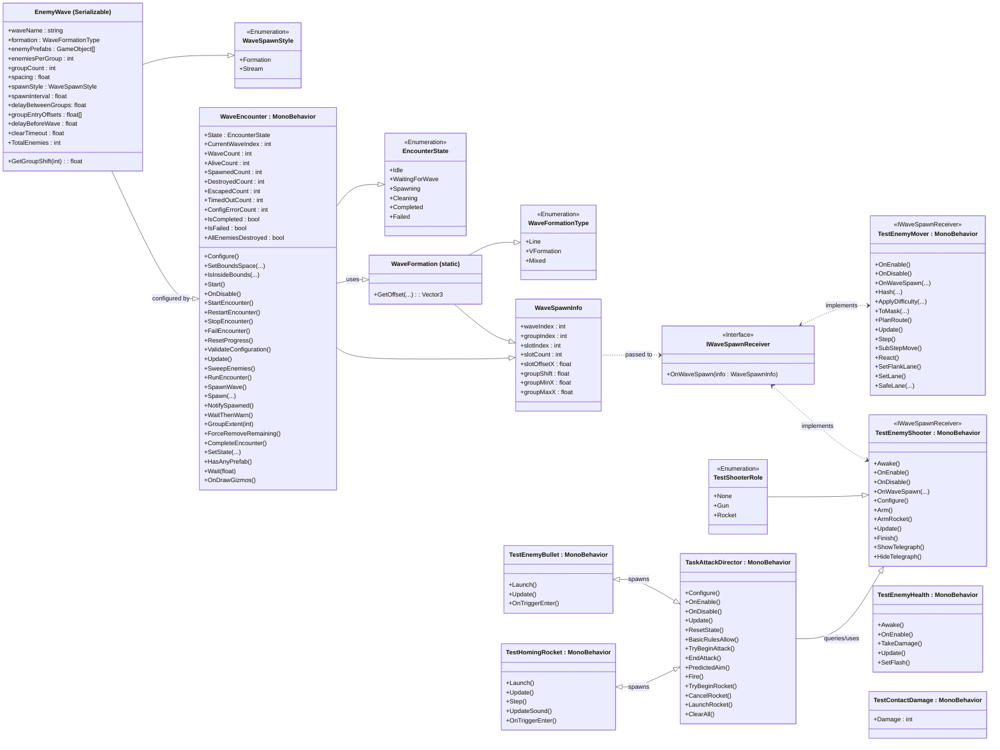

# GDD v.1 contribution

Established general enemy behavior concepts and identifies enemy parameters

# Prototype summary

Basic enemy movement, single enemy type, two projectile types, basic wave configuration.

# Enemy mechanics architecture:

## Wave Configuration & Spawning

### EnemyWave.cs

Wave definition class

- Wave identification
- Wave formation
- Enemy prefabs selection
- Number of enemies per group
- Number of groups per wave
- Spawn behavior (simultaneous/individual)
- Spawn location (left/center/right)
- Wave duration
- Wave delay (display game info)

### WaveEncounter.cs

Executes waves, spawns enemies, monitors their status and manages encounter completion

- Starting and stopping encounters
- Progressing through multiple waves
- Spawning enemy groups
- Tracking active enemies
- Detecting destroyed and escaped enemies
- Handling timeouts
- Reporting encounter events to other systems
- Determining when an encounter is completed or failed

### WaveFormation.cs

Calculates the initial positions of enemies within a group

- Generating line formations
- Generating V-shaped formations
- Generating mixed formations
- Calculating horizontal spacing between enemies
- Determining each enemy's position relative to the spawn origin

### WaveSpawnInfo.cs

Defines and communicates information about an enemy's position and role within a spawned group

- Identifying the current wave
- Identifying the enemy's group
- Identifying the enemy's position (slot) within the group
- Recording the total number of enemies in the group
- Recording the enemy's horizontal formation offset
- Recording the group's horizontal shift
- Recording the group's horizontal boundaries

### IWaveSpawnReceiver.cs

Defines an interface for enemy components that need to receive information when an enemy is spawned

- Receiving WaveSpawnInfo from WaveEncounter
- Allowing different enemy components to respond to spawning
- Providing a common method for processing spawn information

## Enemy AI & Behaviour

### TestEnemyMover.cs

Controls enemy movement and determines how enemies travel through the game environment after spawning

- Selecting enemy movement patterns
- Defining movement speed and acceleration
- Controlling turning speed and direction
- Planning enemy routes
- Moving enemies through waypoints
- Performing curved, straight, flanking, and sweeping movements
- Adjusting movement based on player position
- Maintaining safe movement lanes
- Preventing enemies from entering restricted areas
- Applying wave difficulty settings
- Introducing controlled movement variation

### TestEnemyShooter.cs

Controls the attack behaviour of individual enemies and communicates with the central attack director

- Determining whether an enemy can shoot or launch rockets
- Selecting the enemy's attack role
- Configuring attacks based on enemy class and wave difficulty
- Requesting permission from TestAttackDirector
- Preparing and charging attacks
- Displaying attack warnings and telegraphs
- Requesting predicted player aiming positions
- Firing bullets
- Launching homing rockets
- Ending or cancelling attacks

## Difficulty Configuration

### TestDifficultyProfile.cs

Stores the overall difficulty configuration used by the test enemy system

- Defining difficulty settings for individual waves
- Controlling the maximum number of simultaneous enemy attacks
- Setting minimum delays between attacks
- Defining safe firing distances
- Defining enemy firing zones
- Controlling aim-lock timing
- Preventing attacks while the player is recovering
- Limiting simultaneous homing rockets
- Setting minimum rocket launch intervals and distances
- Defining the random seed used for movement variation

### TestWaveDifficulty.cs

Stores movement and attack settings for a specific wave

- Adjusting enemy movement speed
- Adjusting enemy turning speed
- Modifying movement path widths
- Selecting movement patterns for enemy groups
- Configuring enemy reactions to player position
- Defining flanking and pursuit behaviours
- Controlling run-to-run movement variation
- Determining which enemies can shoot
- Configuring shot warning times and projectile speeds
- Configuring burst attacks
- Adjusting aiming prediction
- Determining which enemies can launch homing rockets

This class is defined inside TestDifficultyProfile.cs, rather than in its own file

## Attack & Projectile Management

### TestAttackDirector.cs

Acts as the central coordinator for enemy attacks and projectile spawning

- Managing shared attack rules
- Controlling the number of simultaneous attacks
- Enforcing delays between attacks
- Checking whether enemies are allowed to attack
- Tracking active attacks and pending rockets
- Predicting player positions for aimed attacks
- Spawning and launching enemy bullets
- Managing homing rocket launches
- Coordinating attack reservations and cancellations
- Clearing active attacks and projectiles
- Providing shared information to enemy shooters

### TestEnemyBullet.cs

Controls the behaviour of standard enemy projectiles

- Receiving launch direction and velocity
- Moving projectiles through the environment
- Detecting collisions with other objects
- Removing projectiles after hitting the player
- Removing projectiles after reaching their lifetime limit
- Removing projectiles when they leave the allowed area

### TestHomingRocket.cs

Controls the movement and behaviour of homing rocket projectiles

- Receiving launch direction and target information
- Moving initially in a straight direction
- Waiting for the arming period
- Activating homing behaviour
- Tracking the target with limited turning speed
- Accelerating during flight
- Controlling the duration of homing behaviour
- Detecting collisions
- Managing rocket sound effects
- Removing rockets after their lifetime expires

## Enemy Health & Player Interaction

### TestEnemyHealth.cs

Manages enemy health and handles enemy destruction

- Initializing enemy health
- Receiving damage from external systems
- Tracking remaining health
- Detecting when health reaches zero
- Displaying visual damage feedback
- Triggering explosion effects
- Destroying defeated enemies

### TestContactDamage.cs

Defines the amount of damage an enemy causes when it touches the player

- Storing the enemy's contact damage value
- Providing the damage value to the player health system
- Identifying objects that can cause contact damage

# Class diagram

